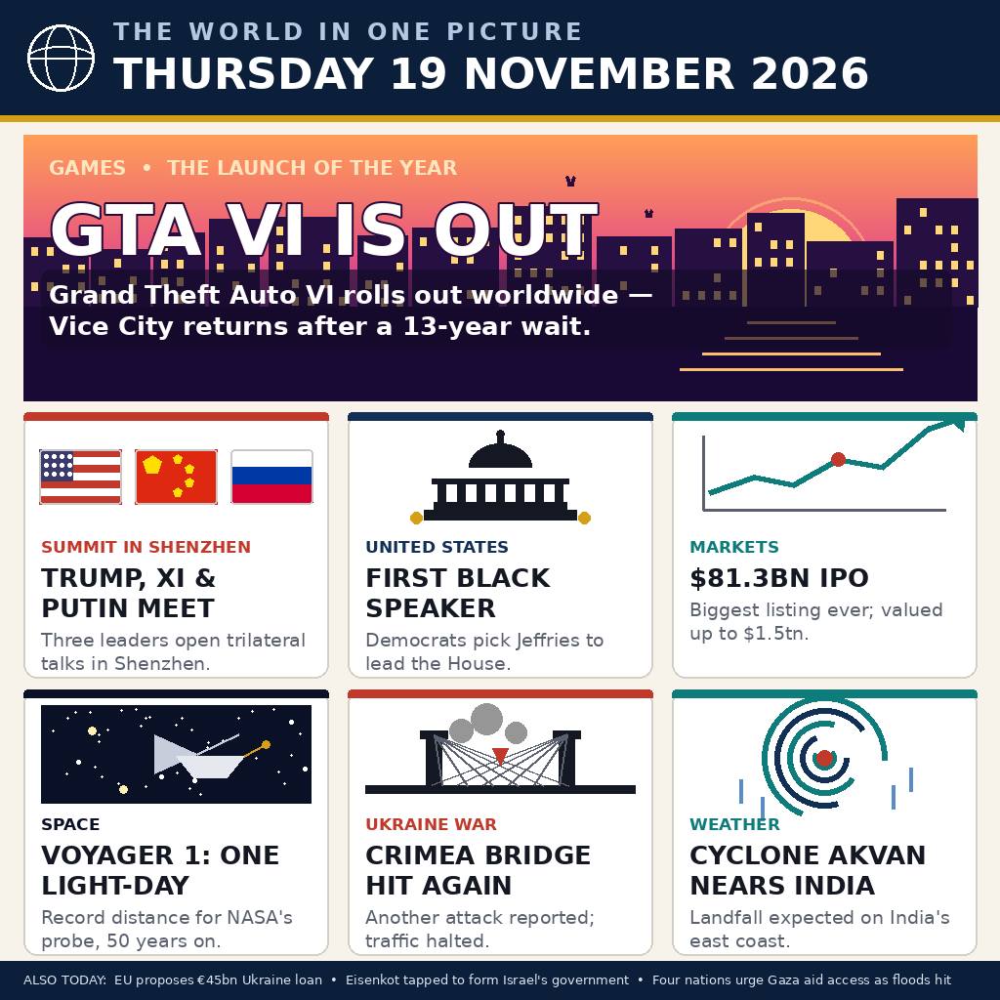

# 🗞️ The World in One Picture — Daily News Infographic


One poster, the whole day: a programmatically generated 1024×1024 news infographic — a daily-edition generator — this is the edition of **19 November 2026**, the GTA VI launch day.



## 🧩 What's on the poster
- **Lead story:** GTA VI launch day, with a stats strip (price, platforms, pre-load, records).
- Six world stories: Artemis II crew, AI summit, market record, fusion milestone, climate talks, World Cup draw.
- A headline ticker along the bottom edge.

## 🛠️ How it works
`draw_poster.py` lays out the entire poster in code (Pillow): panels, typography, colour system — no design tools, fully deterministic output. `main.ts` is the entrypoint wrapper.

## 🚀 Run
```bash
python3 draw_poster.py   # writes entry.png
```

## 👤 Author
**Kamal Mosadegh** — freelance developer · [Portfolio](https://kamalmosadegh.github.io) · kamalmosadegh6977@gmail.com

MIT licensed.
